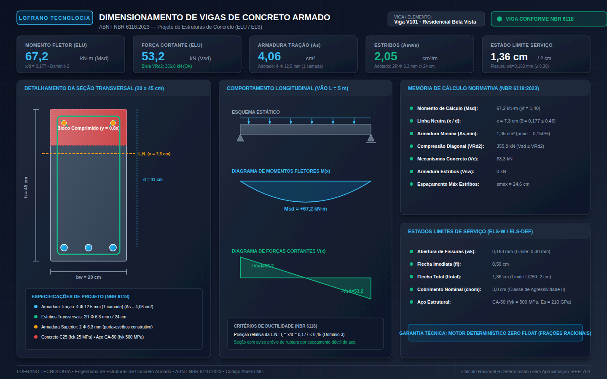

# Dimensionamento e Verificação de Vigas de Concreto Armado (ABNT NBR 6118:2023)

[](https://github.com/martinlofranodeoliveira/dimensionamento-vigas-concreto-nbr6118/actions/workflows/ci.yml)
[](LICENSE)
[](https://www.python.org/)
[](#garantias-técnicas)
[-emerald.svg)](#aritmética-exata-zero-float)
[](https://www.abnt.org.br/)

Motor analítico, determinístico e de código aberto para dimensionamento, verificação estrutural e detalhamento normativo de vigas retangulares de concreto armado segundo os preceitos rigorosos da **ABNT NBR 6118:2023** (*Projeto de estruturas de concreto - Procedimento*).

Projetado sob a filosofia de engenharia de software de alta confiabilidade da **LOFRANO TECNOLOGIA**, este motor opera com **Zero Float** (100% dos cálculos físicos, geométricos e normativos utilizam o tipo `Fraction` e inteiros da biblioteca padrão do Python), eliminando erros de truncamento e imprecisões binárias IEEE-754.

---

## Painel Técnico Vetorial (Renderização 1440x900)

O motor gera automaticamente um painel técnico vetorial SVG em alta resolução contendo a seção transversal detalhada (com estribos, barras tracionadas e comprimidas), o bloco retangular de tensões, a linha neutra, os diagramas de momentos fletores $M(x)$ e forças cortantes $V(x)$, e a memória de cálculo consolidada com selo de aprovação:



---

## Fundamentação Matemática e Formulações Normativas

O pacote implementa as formulações analíticas fundamentais da **ABNT NBR 6118:2023** para os Estados Limites Últimos (ELU) e de Serviço (ELS):

### 1. Flexão Simples no Estado Limite Último (ELU)
- **Diagrama Retangular Simplificado de Tensões** (Item 17.2.2):
  Para concretos do Grupo I ($f_{ck} \le 50\text{ MPa}$):
  $$\sigma_{cd} = \alpha_c \cdot f_{cd} = 0{,}85 \cdot \frac{f_{ck}}{\gamma_c}$$
  $$\lambda = 0{,}80, \quad y = \lambda \cdot x = 0{,}80 \cdot x$$
- **Equilíbrio de Forças e Parâmetro Adimensional $\mu$**:
  $$M_{sd} = \gamma_f \cdot M_k = 1{,}40 \cdot M_k$$
  $$\mu = \frac{M_{sd}}{b_w \cdot d^2 \cdot \sigma_{cd}}$$
- **Posição da Linha Neutra e Relação Adimensional $\xi$**:
  $$\xi = \frac{x}{d} = \frac{1 - \sqrt{1 - 2\mu}}{\lambda} = \frac{1 - \sqrt{1 - 2\mu}}{0{,}80}$$
  Onde a raiz quadrada racional $\sqrt{1 - 2\mu}$ é calculada pelo algoritmo `raiz_quadrada_fracao` sem utilizar qualquer ponto flutuante.
- **Limite de Ductilidade e Redistribuição de Esforços** (Item 14.6.4.3):
  Para garantir comportamento dúctil antes da ruptura:
  $$\xi \le 0{,}45 \quad (\text{Domínio 2 ou Domínio 3})$$
  - Se $\xi \le 0{,}45$: **Armadura Simples**:
    $$z = d \cdot (1 - 0{,}40 \cdot \xi)$$
    $$A_s = \frac{M_{sd}}{f_{yd} \cdot z}, \quad f_{yd} = \frac{f_{yk}}{\gamma_s} = \frac{500}{1{,}15} = 43{,}478\dots\text{ kN/cm}^2$$
  - Se $\mu > 0{,}2952$ ($\xi > 0{,}45$): **Armadura Dupla** necessária para fixar $\xi = 0{,}45$:
    $$M_{sd,\lim} = 0{,}2952 \cdot b_w \cdot d^2 \cdot \sigma_{cd}$$
    $$\Delta M_{sd} = M_{sd} - M_{sd,\lim}$$
    $$A_{s,1} = \frac{M_{sd,\lim}}{f_{yd} \cdot d \cdot (1 - 0{,}40 \cdot 0{,}45)}$$
    $$A_s' = \frac{\Delta M_{sd}}{f_{yd} \cdot (d - d')}, \quad A_s = A_{s,1} + A_s'$$

### 2. Taxas Mínima e Máxima de Armadura Longitudinal
- **Armadura Mínima de Flexão** (Tabela 17.3 da NBR 6118):
  Evita a ruptura frágil no momento em que o concreto tracionado fissura:
  $$A_{s,\min} = \rho_{\min} \cdot A_c = \rho_{\min} \cdot (b_w \cdot h)$$
  Onde $\rho_{\min}$ varia de $0{,}150\%$ (C20/C25) até $0{,}288\%$ (C50).
- **Armadura Máxima**:
  $$A_{s,\max} \le 0{,}04 \cdot A_c = 4\% \cdot (b_w \cdot h)$$

### 3. Cisalhamento no ELU (Modelo de Cálculo I - Item 19.4.1)
- **Verificação da Biela de Compressão Diagonal do Concreto**:
  $$V_{sd} = \gamma_f \cdot V_k = 1{,}40 \cdot V_k$$
  $$V_{Rd2} = 0{,}27 \cdot \left(1 - \frac{f_{ck}}{250}\right) \cdot f_{cd} \cdot b_w \cdot d$$
  Condição mandatória para evitar esmagamento do concreto: $V_{sd} \le V_{Rd2}$.
- **Mecanismos Complementares do Concreto ($V_c$)**:
  $$V_c = 0{,}60 \cdot f_{ctd} \cdot b_w \cdot d, \quad f_{ctd} = \frac{0{,}70 \cdot 0{,}30 \cdot f_{ck}^{2/3}}{\gamma_c}$$
- **Armadura Transversal de Estribos ($V_{sw}$)**:
  - Se $V_{sd} \le V_c \implies V_{sw} = 0$ (adota-se armadura mínima).
  - Se $V_{sd} > V_c \implies V_{sw} = V_{sd} - V_c$:
    $$\left(\frac{A_{sw}}{s}\right) = \frac{V_{sw}}{0{,}90 \cdot d \cdot f_{ywd}}$$
- **Armadura Transversal Mínima**:
  $$\left(\frac{A_{sw}}{s}\right)_{\min} = 0{,}20 \cdot \frac{f_{ctm}}{f_{ywk}} \cdot b_w$$
- **Espaçamento Máximo Normativo de Estribos ($s_{\max}$)**:
  - Se $V_{sd} \le 0{,}67 \cdot V_{Rd2} \implies s_{\max} = 0{,}60 \cdot d \le 300\text{ mm}$.
  - Se $V_{sd} > 0{,}67 \cdot V_{Rd2} \implies s_{\max} = 0{,}30 \cdot d \le 200\text{ mm}$.

### 4. Verificação dos Estados Limites de Serviço (ELS)
- **Abertura Estimada de Fissuras ($w_k$ - Item 17.3.3.2)**:
  $$w_k = \frac{\phi}{12{,}5 \cdot \eta_1} \cdot \frac{\sigma_s}{E_s} \cdot \frac{3 \cdot \sigma_s}{f_{ctm}} \le w_{\lim}$$
  Onde $\eta_1 = 2{,}25$ para barras nervuradas CA-50 e $w_{\lim} \in \{0{,}4\text{ mm}, 0{,}3\text{ mm}, 0{,}2\text{ mm}\}$ conforme a Classe de Agressividade Ambiental (CAA I a IV).
- **Deformação Excessiva / Flecha Total Diferida no Tempo (ELS-DEF)**:
  $$f_i = \frac{5}{48} \cdot \frac{M_{\text{serv}} \cdot L^2}{E_{cs} \cdot I_{eq}}, \quad f_{\text{total}} = f_i \cdot (1 + \alpha_f) \le \frac{L}{250}$$
  Com $\alpha_f = 1{,}32$ para efeitos de fluência diferida a longo prazo.

---

## Garantias Técnicas LOFRANO TECNOLOGIA

1. **Aritmética Exata (Zero Float)**: Todos os tipos de dados contínuos utilizam `fractions.Fraction`.
2. **Codec Canônico JSON**: Rejeição sumária de floats, BOM UTF-8 (`\xef\xbb\xbf` / `\ufeff`), chaves duplicadas e aninhamentos com profundidade superior a 32 níveis.
3. **Segurança CSV**: Sanitização ativa contra injeção de fórmulas de planilhas (prefixo `'` em `=`, `+`, `-`, `@`, `\t`, `\r`).
4. **Painel SVG 1440x900**: Visualização vetorial de seção transversal, estribos, linha neutra e diagramas $M(x)$ e $V(x)$.
5. **Captura Headless Chrome**: Validação visual automatizada gerando `docs/exemplo.png`.
6. **Empacotamento ZIP Determinístico**: Geração byte-a-byte idêntica com timestamp fixado (`2026-01-01 00:00:00`) e flags seguras `os.O_EXCL | os.O_CREAT`.
7. **Suíte Completa com 55+ Testes**: Cobertura integral das formulações da NBR 6118.
8. **Auditor Independente em SQLite (`tools/verify_independent.py`)**: Validador analítico executado em banco `:memory:` sem importar módulos do projeto.
9. **CI Multiplataforma**: Testado em Linux (Python 3.11, 3.12, 3.13, 3.14) e Windows (Python 3.14) com isolamento total de rede (`unshare -r -n`).

---

## Estrutura do Repositório

```text
.
├── .github/workflows/ci.yml           # CI multiplataforma (Linux + Windows + isolamento de rede)
├── docs/
│   ├── exemplo.svg                    # Painel vetorial SVG gerado
│   └── exemplo.png                    # Captura PNG 1440x900 via Chrome Headless
├── examples/
│   ├── viga_residencial_biapoiada.json       # Exemplo de viga com armadura simples
│   └── viga_edificio_armadura_dupla.json     # Exemplo de viga com armadura dupla
├── src/vigas_concreto_nbr6118/
│   ├── __init__.py                    # Exportação da API pública e metadados
│   ├── py.typed                       # Marcador PEP 561 de conformidade de tipos
│   ├── constants.py                   # Constantes, tabelas CAA, concretos C20-C50 e aços
│   ├── models.py                      # Dataclasses de domínio imutáveis com Fraction
│   ├── calculator.py                  # Motor analítico ELU (flexão/cisalhamento) e ELS
│   ├── codecs.py                      # Serializador/desserializador canônico JSON Zero Float
│   ├── exporters.py                   # Exportador CSV anti-injeção e memorial técnico
│   ├── svg_generator.py               # Renderizador vetorial SVG 1440x900 da viga
│   └── cli.py                         # Interface CLI completa e determinística
├── tests/
│   ├── test_constants.py              # Testes das tabelas normativas da NBR 6118
│   ├── test_models.py                 # Validação de regras de integridade e tipos
│   ├── test_calculator.py             # Testes analíticos de flexão, cisalhamento e ELS
│   ├── test_codecs.py                 # Testes do codec JSON (Zero Float, sem BOM/duplicatas)
│   ├── test_exporters.py              # Testes de sanitização CSV e geração de memorial
│   ├── test_svg_generator.py          # Testes de formato, viewBox e tags SVG
│   ├── test_cli.py                    # Testes de todos os subcomandos e saídas
│   └── test_packaging.py              # Testes PEP 561 e conformidade de empacotamento
├── tools/
│   └── verify_independent.py          # Auditor independente em SQLite em memória
├── scripts/
│   ├── generate_assets.py             # Geração de painéis, screenshots e distribuição
│   └── check_distribution.py          # Verificador de integridade de checksums SHA256
├── LICENSE                            # Licença MIT
├── pyproject.toml                     # Configuração padronizada PEP 517 / PEP 621
└── README.md                          # Este documento descritivo
```

---

## Instalação

O projeto requer **Python 3.11 ou superior** e não possui nenhuma dependência de terceiros em runtime:

```bash
git clone https://github.com/martinlofranodeoliveira/dimensionamento-vigas-concreto-nbr6118.git
cd dimensionamento-vigas-concreto-nbr6118
pip install .
```

---

## Guia de Uso da Linha de Comando (CLI)

O executável de linha de comando `vigas-concreto` disponibiliza 4 subcomandos:

### 1. Dimensionamento via Arquivo JSON
```bash
vigas-concreto dimensionar -a examples/viga_residencial_biapoiada.json
```

### 2. Dimensionamento Direto por Parâmetros
```bash
vigas-concreto dimensionar --bw 20 --h 45 --vao 5.0 --mk 48 --vk 38 --fck 25 --caa CAA_II
```

### 3. Geração de Todos os Artefatos (JSON, CSV, Memorial e SVG)
```bash
vigas-concreto dimensionar \
  -a examples/viga_residencial_biapoiada.json \
  --saida-json resultado.json \
  --saida-csv planilha.csv \
  --saida-relatorio memorial.txt \
  --painel-svg painel.svg
```

### 4. Consulta de Tabelas Normativas e Materiais
```bash
# Tabelas de Agressividade Ambiental e Armadura Mínima
vigas-concreto tabelas

# Classes de Concreto, Aços e Bitolas Comerciais
vigas-concreto materiais

# Versão do Motor
vigas-concreto versao
```

---

## Uso Programático via API Python

```python
from fractions import Fraction
from vigas_concreto_nbr6118 import (
    ProjetoViga,
    SecaoViga,
    PropriedadesMateriais,
    EsforcosSolicitantes,
    dimensionar_viga_concreto,
    gerar_relatorio_memorial,
    exportar_csv,
    gerar_painel_svg,
)

# 1. Definir os dados da viga com aritmética racional
projeto = ProjetoViga(
    identificacao="Viga V101 - Residencial",
    secao=SecaoViga(
        largura_bw_cm=Fraction(20, 1),
        altura_h_cm=Fraction(45, 1),
        comprimento_vao_m=Fraction(5, 1),
        tipo_apoio="biapoiada",
    ),
    materiais=PropriedadesMateriais(
        classe_concreto_fck=25,
        classe_agressividade="CAA_II",
    ),
    esforcos=EsforcosSolicitantes(
        momento_fletor_k_kNm=Fraction(48, 1),
        forca_cortante_k_kN=Fraction(38, 1),
    ),
)

# 2. Executar dimensionamento analítico
resultado = dimensionar_viga_concreto(projeto)

# 3. Inspecionar resultados normativos
print("Status de Aprovação:", "APROVADO" if resultado.atende_geral else "REPROVADO")
print("Tipo de Armadura:", resultado.resultado_flexao.tipo_armadura)
print(f"Área de Aço Longitudinal (As): {float(resultado.resultado_flexao.area_aco_tracao_final_cm2):.2f} cm²")
print(f"Taxa Transversal Estribos (Asw): {float(resultado.resultado_cisalhamento.area_estribos_por_metro_final_cm2_m):.2f} cm²/m")
print(f"Detalhamento: {resultado.resultado_detalhamento.barras_tracao}")

# 4. Exportar memorial e planilha técnica
memorial_txt = gerar_relatorio_memorial(resultado)
planilha_csv = exportar_csv(resultado)
painel_svg = gerar_painel_svg(resultado)
```

---

## Auditoria Independente em SQLite

Para certificar a integridade dos cálculos sem interferência de bibliotecas de produção, execute o validador independente:

```bash
python3 tools/verify_independent.py
```

O auditor carrega os modelos em banco de dados SQLite em memória, calcula os equilíbrios de flexão e biela de forma independente e confirma a conformidade normativa dos projetos de teste.

---

## Execução da Suíte de Testes

```bash
PYTHONPATH=src python3 -m unittest discover -s tests
```

---

## Licença

Distribuído sob a licença **MIT**. Consulte o arquivo [LICENSE](LICENSE) para mais detalhes.

---

**LOFRANO TECNOLOGIA**  
Engenharia de Estruturas de Concreto Armado • Soluções Determinísticas • ABNT NBR 6118:2023
